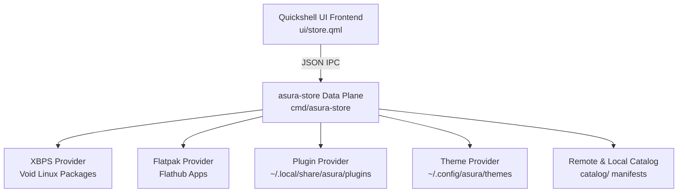

# Asura Store

[](https://github.com/ASURA-OS/asura-store/actions/workflows/ci.yml)
[](LICENSE)

Official application, plugin, and theme store for **[Asura OS](https://github.com/mohitjoer/ASURA-OS)**.

Asura Store provides an integrated graphical showroom and high-speed data plane CLI for browsing, searching, and managing:
- **System Applications**: Native XBPS packages for Void Linux and curated Flatpaks.
- **Plugins**: Community desktop widgets, system trays, and Quickshell extensions.
- **Bar Styles**: Visual top bar presets and island layouts (Nacre, Sumi, Minimal).
- **Themes & Rices**: Obsidian cyber color palettes and complete desktop rices.

---

## Architecture Overview



### Key Components

| Directory | Purpose |
|---|---|
| `cmd/asura-store/` | Go data plane: catalogue compilation, multi-provider concurrent probing, polkit privilege hand-off, and JSON streaming. |
| `ui/` | Quickshell frontend: product detail overlays, showroom stage, progress readout, and search shelf. |
| `catalog/` | Curated metadata manifests for community plugins, themes, and bar styles. |

---

## CLI Usage

The `asura-store` backend communicates via JSON streaming:

```bash
# Query complete catalog across all providers
asura-store catalog

# Refresh and query a specific category (apps, plugins, barstyles, themes)
asura-store catalog --refresh --category plugins

# Search applications and package repositories
asura-store search vlc

# Install a package or plugin (streams progress JSON)
asura-store install apps vlc

# Remove an item
asura-store remove plugins pomodoro

# Open the store GUI window
asura-store open discover
```

---

## Development & Testing

### Prerequisites
- Go 1.22+
- Node.js 20+ (for store helper tests)
- Quickshell (optional, to run the UI standalone)

### Building & Running Tests

```bash
# Build the backend binary
make build

# Run all test suites (Go + Node.js)
make test

# Launch the standalone QML UI
make run-ui
```

---

## License

This project is licensed under the **GNU General Public License v3.0** ([GPL-3.0](LICENSE)).
