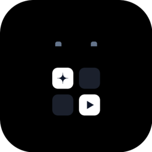
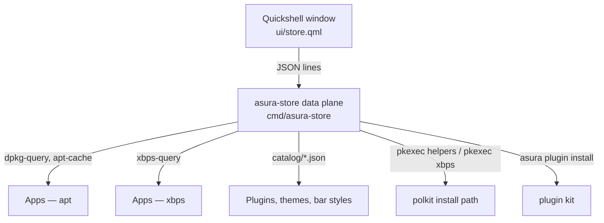

<p align="center">
  
</p>

# Asura Store

[](https://github.com/ASURA-OS/asura-store/actions/workflows/ci.yml)
[](LICENSE)
[](CODE_OF_CONDUCT.md)

The software store of the **[ASURA OS](https://github.com/mohitjoer/ASURA-OS)** desktop:
a Quickshell showroom window and a small Go data plane that browse, search, install and
remove software. It is a port of Ryoku's **RyoStore** — the window and the backend come
from [`apps/ryostore`](https://github.com/ryoku-dev/ryoku) in the Ryoku tree, rebranded
and rewired for ASURA. [NOTICE.md](NOTICE.md) is the honest ledger of what came across
and what did not.

| Shelf | What it offers | Where it comes from |
|---|---|---|
| **Apps** | vlc, gimp, blender, keepassxc, steam and the rest of the Discover seeds | the Ubuntu archive via apt (`dpkg-query`, `apt-cache`), or Void Linux's repositories via `xbps-query` |
| **Bar styles** | the shell's built-in bar compositions | built into the shell — list only, install and remove refuse |
| **Plugins** | widgets, overlays, integrations | `catalog/plugins/*.json`; install runs `asura plugin install <upstream>` from the entry's upstream repo |
| **Themes & rices** | palettes and appearance sets | `catalog/themes/*.json`, the shipped themes, and theme directories on disk — activation, not download |

Deliberately: **no remote registry, no Flatpak, no snapshot cache**. The catalogue is
the checked-in JSON under `catalog/`, the package manager and the plugin folder. There
is no meta-store to reconcile against, so a machine with no network still renders its
whole shelf.

## Architecture



- `cmd/asura-store/` — the Go data plane: one JSON contract for every source,
  concurrent provider probing, the polkit privilege path (this process never holds a
  privilege and never runs sudo), and the compilation-revision the refresh dot reads.
- `ui/` — the Quickshell window: the showroom stage, product covers and detail
  overlays, search shelf and status readout. Its logic lives in `ui/lib/store.js`
  beside its tests.
- `catalog/` — the local catalogue: `plugins/`, `themes/`, `barstyles/`, one JSON
  manifest per item. `make install` stages it to `/usr/share/asura/store/catalog/`,
  so a checkout update changes the shelf without a rebuild.

## The commands

```bash
asura-store catalog                  # the whole shelf as JSON
asura-store catalog --category themes          # one category, alone
asura-store catalog --refresh                  # bypass any fresh in-process cache
asura-store search "video editor"              # apt/xbps hits, JSON
asura-store check                              # {"revision","updateAvailable","offline"}
asura-store install apps vlc                   # {"stage","percent"} progress lines
asura-store remove apps vlc
asura-store open discover                      # the OS-session subcommands
asura-store settings themes                    # (need the ASURA shell installed)
```

Every reading command answers JSON and writes nothing else to stdout. Every failing
invocation answers one sentence on stderr and exits 1. While an install or a removal
works, one `{"stage","percent"}` JSON line per step goes to stdout — `AUTHORIZING`,
`DOWNLOADING`, `INSTALLING` (or `REMOVING`) — and a failure is still a single sentence
on stderr, which the window shows. Cancel is honoured until dpkg starts; after that the
transaction runs to its end rather than leave a half-configured system.

`check` answers the refresh-dot contract: a revision (a SHA-256 over what the catalogue
offers, ignoring volatile state), `updateAvailable` only when the revision has moved
past the one the user last looked at, and an `offline` flag. Viewing the catalogue
acknowledges its revision; `check` never does.

The full manual — the JSON contract, how each install happens, the refresh dot, the
window-manager gate, and how to author catalogue entries — is
[docs/store.md](docs/store.md).

## Development

Prerequisites: Go (the toolchain `go.mod` pins, currently 1.26.8), Node.js 22+ for the
window's JavaScript tests, `jq`, and an ASURA OS session to run the window in (note
below). `qmllint` needs the Qt QML toolchain and the two modules the window imports:

```bash
sudo apt-get install qt6-declarative-dev-tools qt6-declarative-dev \
  qml6-module-qtquick qml6-module-qtquick-effects
```

Every day:

```bash
make build                        # builds bin/asura-store
make test                         # go tests + the window's node --test suite
cd cmd/asura-store && go vet ./... && go test -count=1 -race ./...
/usr/lib/qt6/bin/qmllint ../../ui/*.qml    # errors fail; the Quickshell/qs.Ui warnings are expected
gofmt -l cmd                      # must print nothing
```

The window is not a runnable quickshell config in this tree: the entry file
`ui/store.qml` is the distribution's `shell/store.qml` byte-for-byte, written to sit
at the quickshell root — beside the shell's `store/` directory and its `qs.Ui` kit —
which the OS session provides. Start it the way the shell does:
`asura-store open discover`.

[CONTRIBUTING.md](CONTRIBUTING.md) carries the rules that matter: the byte-identical
mirrors in the ASURA-OS tree, the JSON contract you may not break, the commit style,
and the licence.

## Community

- Found a bug? [Open a bug report](https://github.com/ASURA-OS/asura-store/issues/new?template=bug_report.yml).
- Security problems go through private reporting, not public issues —
  [SECURITY.md](SECURITY.md).
- Behaviour expectations: [CODE_OF_CONDUCT.md](CODE_OF_CONDUCT.md).

## Licence and origin

Everything in this repository is **GPL-3.0** ([LICENSE](LICENSE)). The project is a
derivative of Ryoku's RyoStore (GPL-3.0), so its name and link stay in
[NOTICE.md](NOTICE.md) for as long as the code does.
